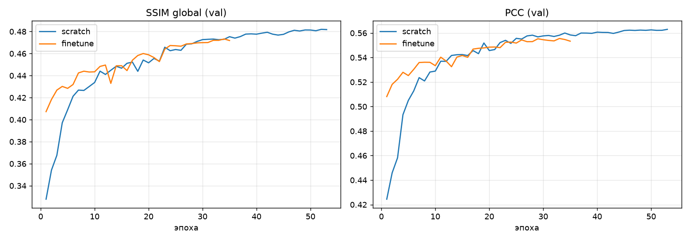
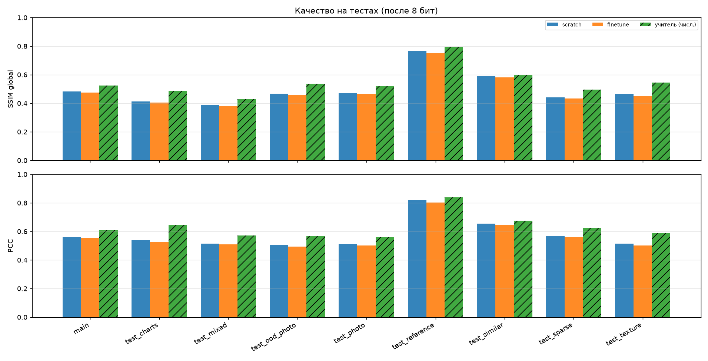

# Результаты опубликованной модели

Отчёт относится к текущему `weights/model.pt`: совместный ResUNet с физическими слоями Френеля, `joint_spectral_v2`, width=32, две обучаемые стадии обратной связи, 2 995 501 параметр. Обучение выполнено с нуля на Tesla V100-SXM2-16GB. При inference сеть непосредственно выдаёт фазовый ДОЭ; GS и Adam не входят в её вычислительный путь.

## Идентификация весов и данных

| Поле | Значение |
|---|---|
| Эпоха / шагов оптимизатора | 53 / 23 850 |
| Выбор checkpoint | Минимальный validation loss |
| Validation loss | 0.9961917726889901 |
| Validation PCC / global SSIM | 0.5629962684736782 / 0.48178664076544775 |
| Train / validation | 1800 / 230 комплектов |
| Основной test | 800 комплектов |
| Вход одного комплекта | Четыре амплитудных изображения 128×128 |

SHA-256 файла inference: `ee5e488bd6af6f61dffdbaa6c5618a7f08c74c6c121b8f284ae0b413193ba405`.

SHA-256 исходного checkpoint: `da7d9f351525980292c86457ccbab11bf0a71a5d8fe1702eae5b1325991cbd87`.

Fingerprint подготовленного train/val/test: `b2d6b47e3a0609344d08ab87c399d031ccdf5fc3f63ed2d44bc8febff1950895`.

Метаданные — [weights/model.json](../weights/model.json). Обучающая выборка стратифицирована по типам сцен из 5000 train и 500 validation; сохранены 1800 и 230 комплектов соответственно. Состав и seed=0 указаны в [training_subset_info.json](../reports/cluster_dataset/training_subset_info.json). Основной test сохранён целиком. [Аудит данных](../reports/cluster_dataset/dataset_audit.json) сообщает об отсутствии точных пиксельных совпадений между частями; недокументированные семантические сходства этим не исключаются.

## История обучения и выбор эпохи

Предоставлена [история 53 эпох](../reports/cluster_dataset/training_history.json). Её запись эпохи 53 точно совпадает с validation-метаданными весов. Эта эпоха имеет минимальный validation loss в предоставленной истории. Максимальный validation SSIM был на эпохе 52: опубликованная модель выбрана по loss, а не по SSIM и не по test.

Конфигурация checkpoint: AdamW, lr=1e-4, weight decay=1e-4, batch=4, seed=0, восемь CPU-потоков, auxiliary weight=0.2. `ReduceLROnPlateau` снижал LR после эпох 22, 26 и 45 до 5e-5, 2.5e-5 и 1.25e-5. Clipping нормы градиентов — 5. Функция потерь и физика описаны в [TRAINING.md](TRAINING.md).

В метаданных указан максимум 100 эпох и patience=10. История заканчивается на эпохе 53 с `bad_epochs=0`; причина завершения запуска в предоставленных файлах не установлена. Эти данные не подтверждают срабатывание ранней остановки или достижение плато. Оценка продолжительности представленных 53 эпох — около 2.25 ч, по сводке 152.6 с/эпоху.

## Тестовые результаты и нормировка

Ниже приведены агрегаты из [исходной CSV](../reports/cluster_dataset/compare_target255.csv): 9 наборов, 1980 комплектов, 7920 изображений. Колонки `scratch_*` относятся к опубликованным весам; `finetune_*` в исходной CSV и иллюстрациях — отдельный сравнительный запуск, его веса в решение не входят. Обозначение «учитель (числ.)» на исходных рисунках относится к численному baseline и не означает обучение сети по его маскам.

По предоставленному описанию test не использовался для обучения или выбора эпохи. При этом по этим же наборам сравнивались варианты обучения; результаты не доказывают качество на новом слепом тесте после выбора варианта решения.

Фаза и реконструкции квантованы в 8 bit. Реконструкция — амплитуда `|U|`, нормированная по своему максимуму. Для сети цель нормируется как `pixel/255`. SSIM глобальный: population-дисперсии, C1=0.01², C2=0.03², range=1. Это не оконный SSIM. Pearson — дополнительная метрика. Внутри набора метрики усредняются по четырём плоскостям и затем по комплектам.

У численного baseline в переданном протоколе цель делится на свой максимум. Поэтому сравнение SSIM в таблице не полностью согласовано по нормировке цели; особенно это затрагивает charts. Сообщённое значение SSIM сети для charts при нормировке цели по максимуму — 0.378 вместо 0.413. Полного согласованного пересчёта по всем сценам в архиве нет. Отношение SSIM сети к baseline не является доказанным процентом достижимого качества или физическим потолком.

| Набор | Комплектов | Сеть: SSIM | Сеть: PCC | GS + Adam: SSIM | GS + Adam: PCC |
|---|---:|---:|---:|---:|---:|
| main | 800 | 0.482912 | 0.562033 | 0.524720 | 0.610850 |
| test_charts | 30 | 0.412748 | 0.536896 | 0.484130 | 0.648010 |
| test_mixed | 150 | 0.388004 | 0.515389 | 0.429230 | 0.572240 |
| test_ood_photo | 200 | 0.466743 | 0.504418 | 0.537010 | 0.569870 |
| test_photo | 300 | 0.472976 | 0.512983 | 0.519310 | 0.560010 |
| test_reference | 50 | 0.764536 | 0.818229 | 0.794200 | 0.839610 |
| test_similar | 150 | 0.589536 | 0.654061 | 0.600470 | 0.676340 |
| test_sparse | 150 | 0.441774 | 0.565327 | 0.494940 | 0.626920 |
| test_texture | 150 | 0.464841 | 0.515490 | 0.545070 | 0.587980 |
| Макросреднее по 9 наборам | — | 0.498230 | 0.576092 | 0.547676 | 0.632426 |
| Среднее с весом по числу комплектов | 1980 | 0.482224 | 0.555032 | 0.529122 | 0.606869 |

Макросреднее даёт каждому набору одинаковый вес; среднее по комплектам использует размеры наборов. Оба значения выше заново вычислены из предоставленной CSV, а не из исходных реконструкций. Их нельзя смешивать. В таблице baseline выше сети по обоим агрегатам на всех девяти наборах при указанных разных правилах нормировки. Наиболее высокое качество сети — reference, наиболее низкий SSIM — mixed. Это описание предоставленных результатов, без оценки статистической значимости по seed.

## Численный baseline

В предоставленных таблицах использован GS, 200 итераций, затем 300 шагов Adam для индивидуальной оптимизации фазовой маски. Численные результаты сохранены в [numeric_gs_adam_summary.md](../reports/cluster_dataset/numeric_gs_adam_summary.md).

Репозиторный `compare.py` реализует другое сравнение: опубликованные веса против обычного четырёхплоскостного GS-200, без Adam. Он использует нормировку цели по максимуму для обоих методов. Его новый запуск создаёт новый результат и не воспроизводит автоматически приведённую здесь таблицу GS + Adam. Исходный скрипт GS + Adam и индивидуальные журналы этой оптимизации в архиве отсутствуют.

## Время работы

Предоставленная [сводка задержек](../reports/cluster_dataset/timing_v100_cpu.md) содержит прогретые измерения без загрузки весов и записи файлов. В её обозначениях `network` — сеть, `pipeline` — сеть и получение 8-bit фазы; это не синтез с четырьмя реконструкциями из benchmark `compare.py`.

| Устройство | Режим | Батч | мс/батч | мс/ДОЭ | ДОЭ/с |
|---|---|---:|---:|---:|---:|
| Tesla V100-SXM2-16GB | network | 1 | 20.29 | 20.293 | 49.3 |
| Tesla V100-SXM2-16GB | pipeline | 1 | 21.44 | 21.438 | 46.6 |
| Tesla V100-SXM2-16GB | network | 16 | 111.93 | 6.996 | 142.9 |
| Tesla V100-SXM2-16GB | pipeline | 16 | 130.49 | 8.156 | 122.6 |
| Tesla V100-SXM2-16GB | network | 64 | 442.51 | 6.914 | 144.6 |
| Tesla V100-SXM2-16GB | pipeline | 64 | 514.78 | 8.043 | 124.3 |
| CPU, 8 потоков | network | 1 | 291.98 | 291.976 | 3.4 |
| CPU, 8 потоков | pipeline | 1 | 293.78 | 293.782 | 3.4 |
| CPU, 8 потоков | network | 16 | 5023.47 | 313.967 | 3.2 |
| CPU, 8 потоков | pipeline | 16 | 5059.24 | 316.202 | 3.2 |

Для GS + Adam переданы 36–58 мс на комплект на той же V100 при пакетной обработке по 50 комплектов. Это другие размеры батча; прямой коэффициент ускорения по этим числам не является сравнением при одинаковой нагрузке. В CSV качества есть отдельные времена 22.74–23.96 мс для сети; они относятся к другому замеру, не заменяют значения таблицы выше. Число повторов, сырые времена и интервалы неопределённости для этих измерений не приложены.

## Иллюстрации и границы проверки

В [каталоге figures](../reports/cluster_dataset/figures/) сохранены предоставленные примеры main, mixed, photo, similar и sparse. В них `scratch` — текущие веса, `finetune` — сравнительный запуск, «учитель» — GS + Adam. Это иллюстрации нескольких сцен, а не дополнительная независимая оценка всей выборки. Смешение глубин и потеря мелких деталей остаются видимыми ограничениями.

Проверены соответствие SHA текущих весов метаданным, совпадение эпохи и validation-значений с историей, минимальность validation loss в предоставленной истории и арифметика агрегатов CSV. Текущие веса также успешно прошли inference пяти встроенных комплектов; CPU Docker-проверка запускала их без сети и проверяла PNG 128×128, 8 bit, Grayscale.

Исходные тестовые изображения, индивидуальные маски, полные реконструкции и журналы GS + Adam не включены в репозиторий. Поэтому метрики текущих весов здесь не заявляются как независимо пересчитанные из исходных PNG; утверждения прежнего эксперимента о побитовом совпадении сотен реконструкций к ним не относятся. Тесты кода проверяют реализацию, а не подтверждают эти тестовые агрегаты.

Сводка с точными значениями, SHA, размерами наборов и ограничениями сохранена в [current_model_summary.json](../reports/cluster_dataset/current_model_summary.json).
